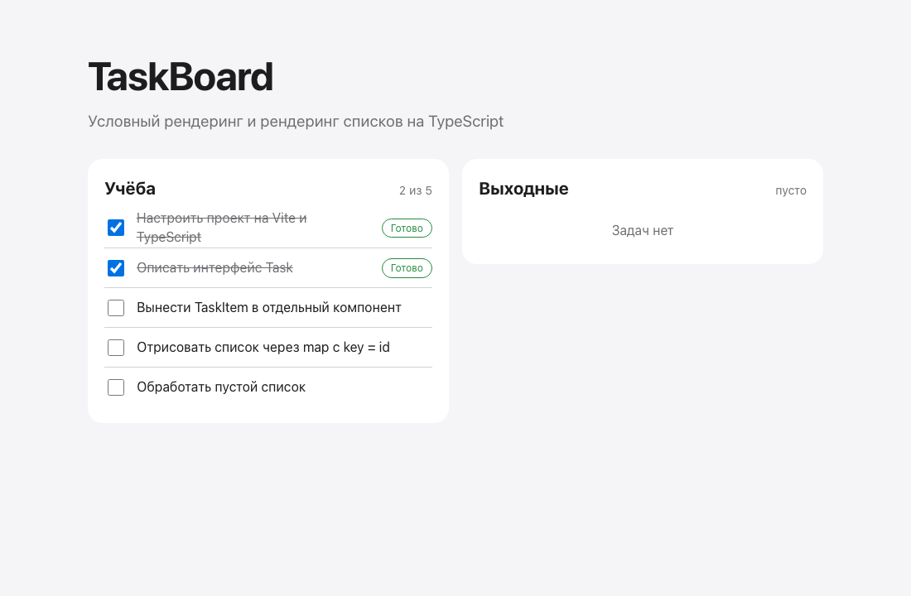

# 01 · Conditional rendering — TaskBoard

- `Task` interface in `src/types/task.ts`.
- `TaskBoard` takes `title`, `tasks: Task[]` and `onToggle`; an empty list renders "Задач нет", otherwise `map` with `key={task.id}`.
- `TaskItem` toggles a CSS Modules class (`done`) and shows a "Готово" badge only for completed tasks.
- `App` keeps the state and renders two boards, one of them empty.

```bash
npm install && npm run dev
```


