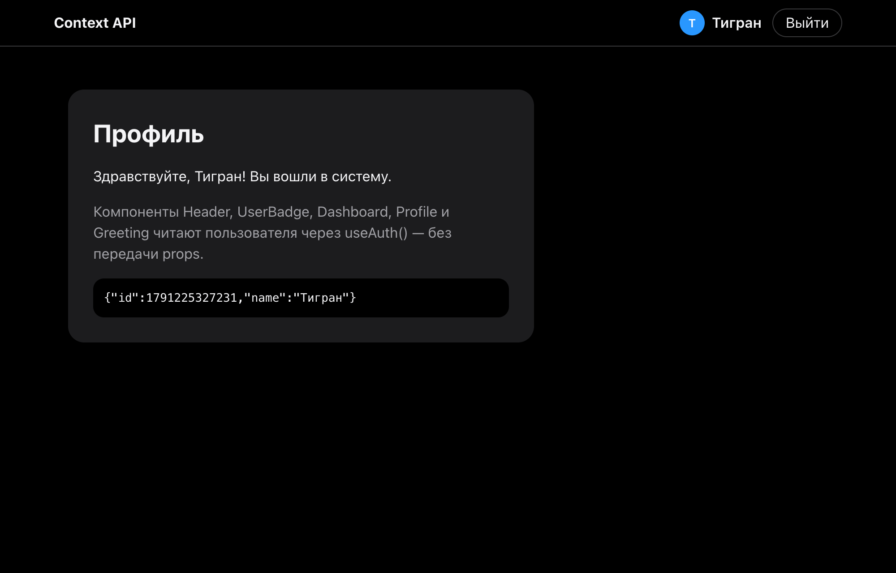

# 02 · Context API — auth without prop drilling

- `AuthContext` stores `user`, `isRestoring`, `login`, `logout`; `AuthProvider` restores the user from `localStorage` in `useEffect`.
- `useAuth` throws when used outside the provider.
- `Header`, `UserBadge`, `Dashboard`, `Profile`, `SessionInfo`, `Greeting`, `LoginForm` all read the context directly, nothing is passed through props.

```bash
npm install && npm run dev
```

| Guest | After reload |
|---|---|
|  |  |
