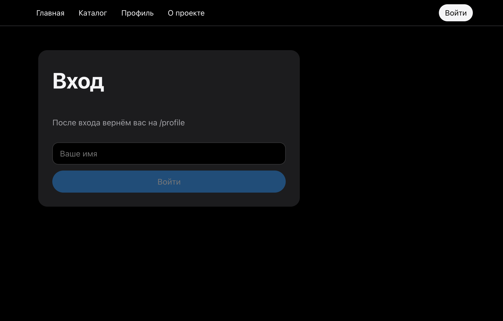
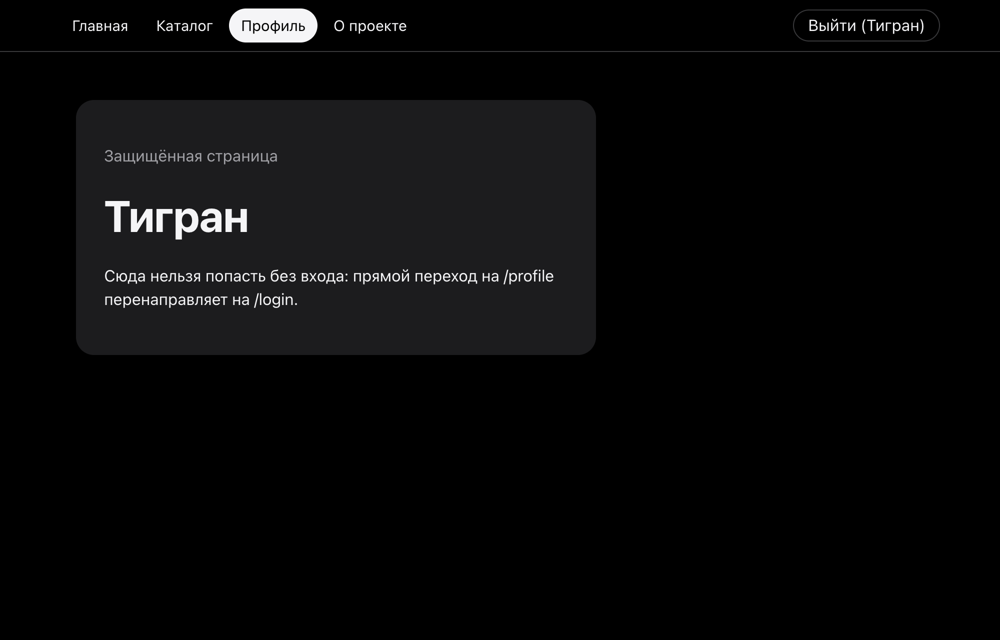
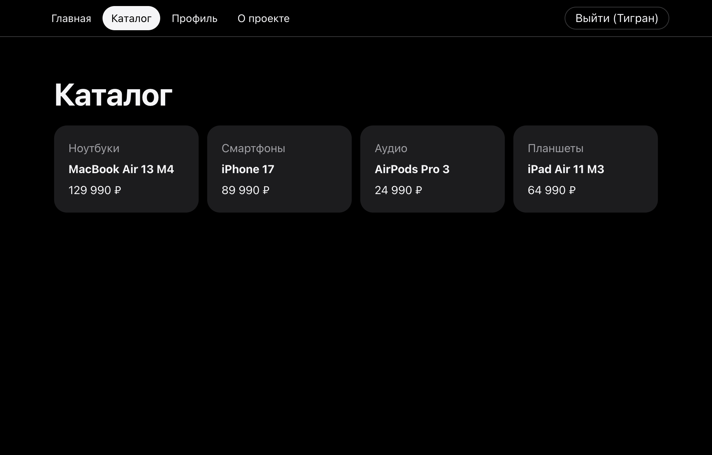
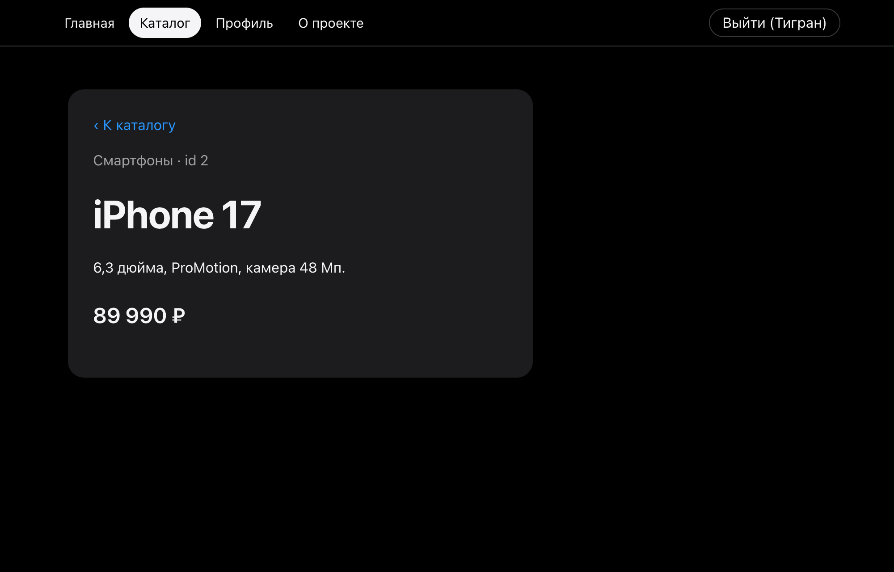
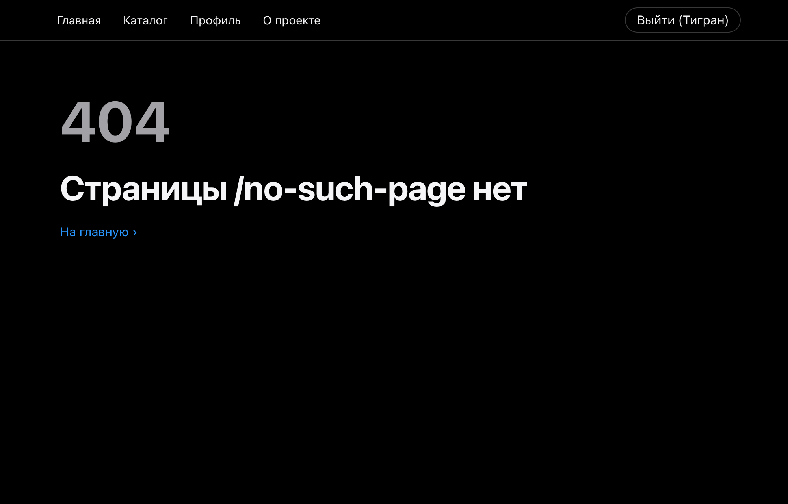

# 03 · Routing and protected routes

- `BrowserRouter` with a shared `AppLayout` (`NavLink` + `Outlet`): `/`, `/products`, `/products/:id`, `/about`, `/login`, `/profile`, `*`.
- `/products/:id` reads a typed `useParams<ProductParams>()`.
- `PrivateRoute` redirects guests to `/login` with `state.from`; after login the user returns to the page they wanted.

```bash
npm install && npm run dev
```

| Redirect to login | Back to profile | Products | Product by id | 404 |
|---|---|---|---|---|
|  |  |  |  |  |
