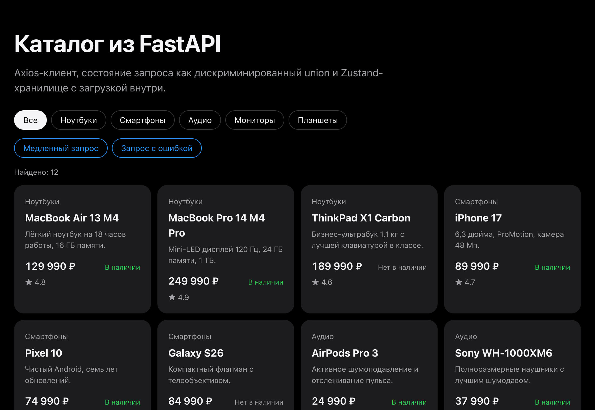
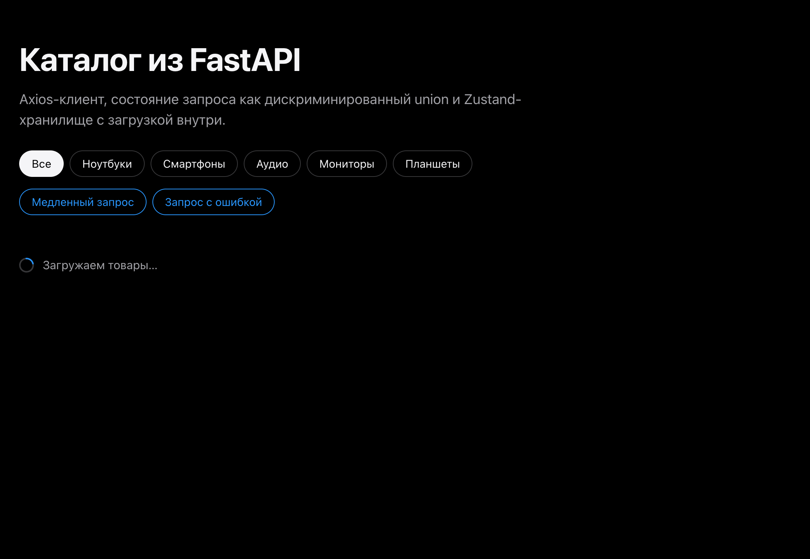
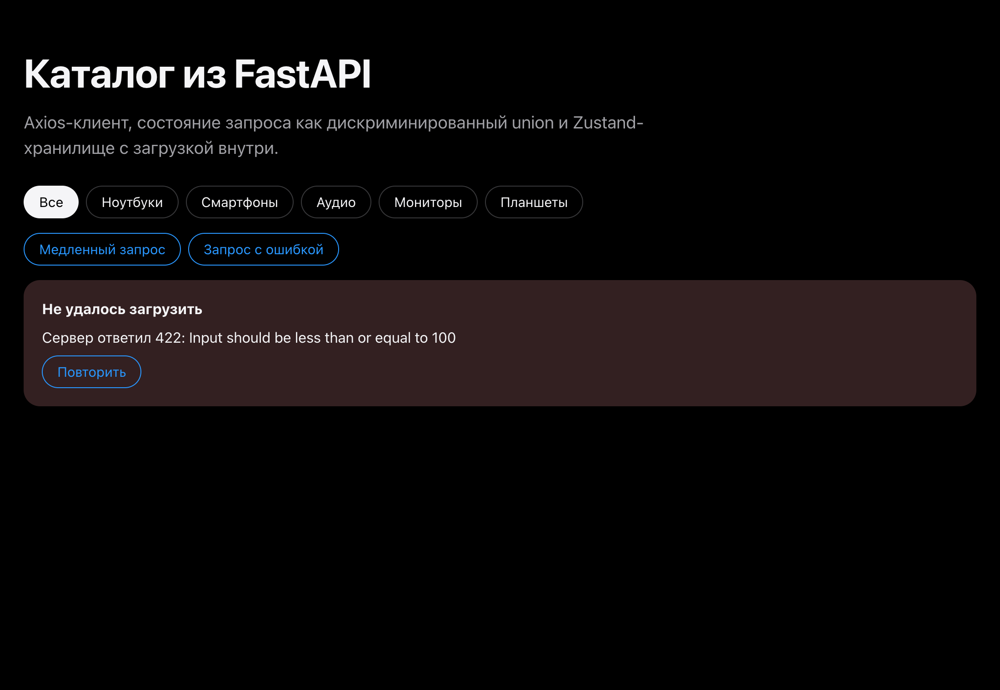
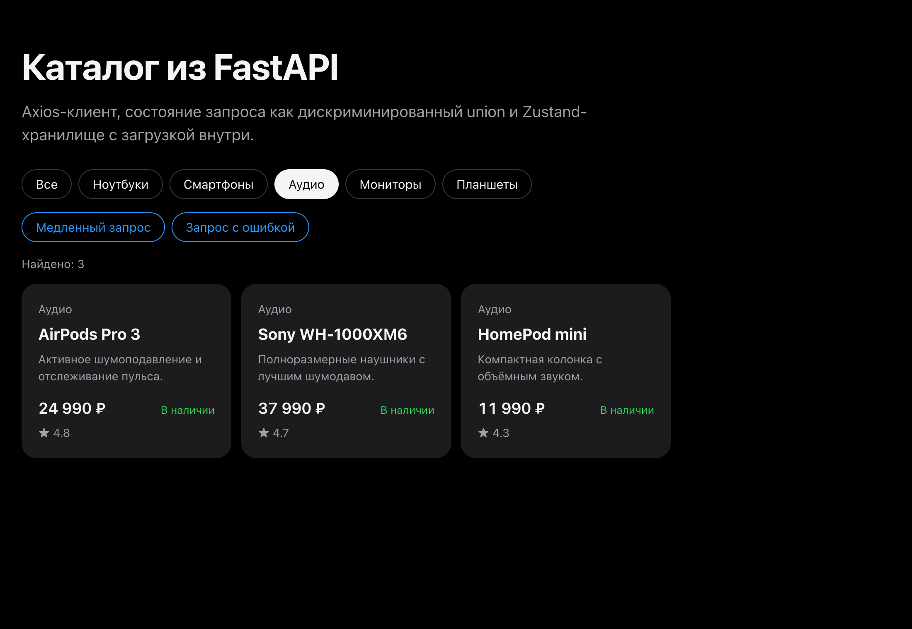

# 04 · FastAPI integration with axios and Zustand

- `src/api/client.ts`: axios instance with `baseURL` from `VITE_API_URL`, typed `fetchProducts`, readable error messages.
- `src/types/request.ts`: `RequestState<T>` — `idle | loading | error | success`, a discriminated union.
- `src/store/productStore.ts`: Zustand store with the selected category and the request state.
- The catalog has buttons for a slow request (`delay_ms=2000`) and a failing one (`limit=1000` → 422) to demonstrate every state.

```bash
cp .env.example .env && npm install && npm run dev
```

Requires the [backend](../backend) on port 8000.

| Success | Loading | Error | Filter |
|---|---|---|---|
|  |  |  |  |
