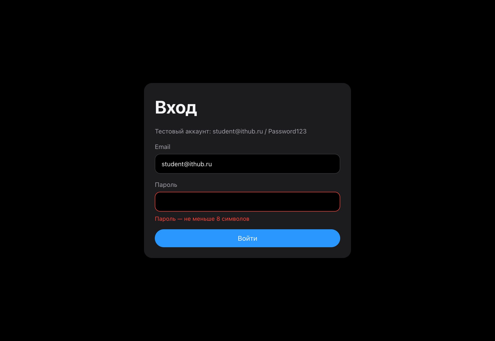
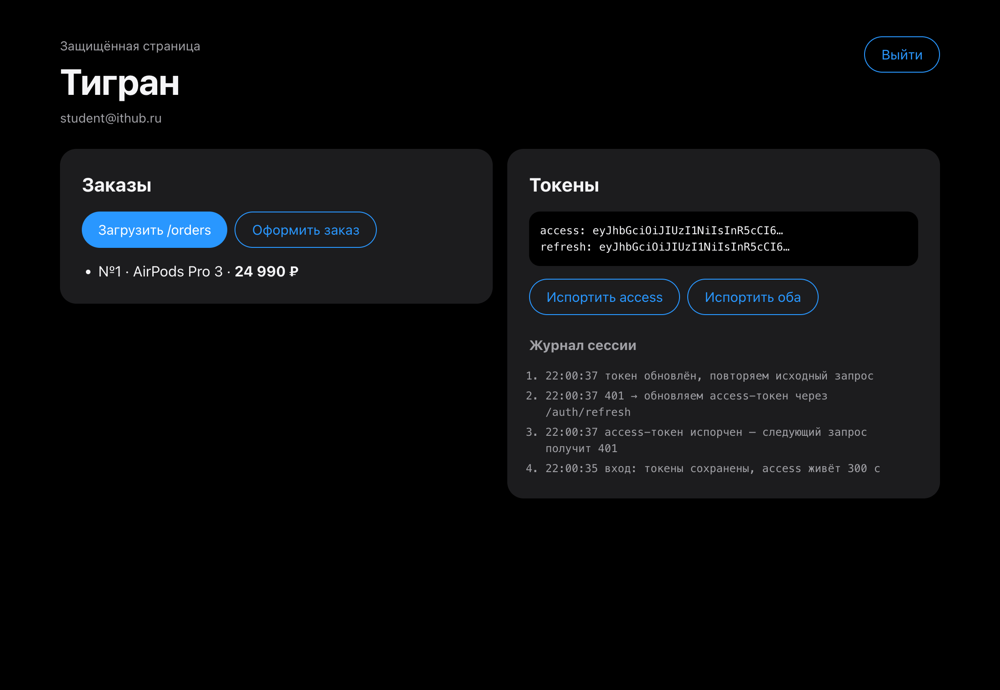
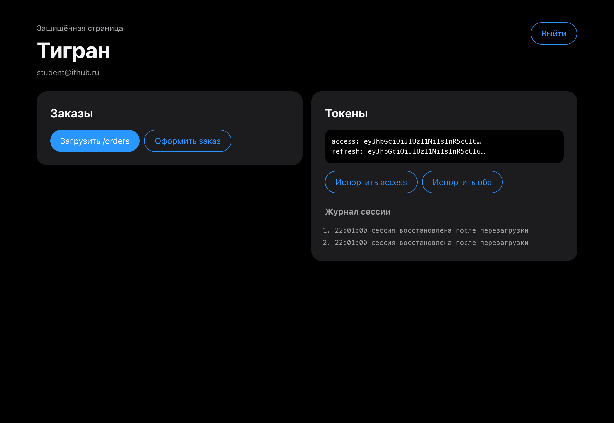
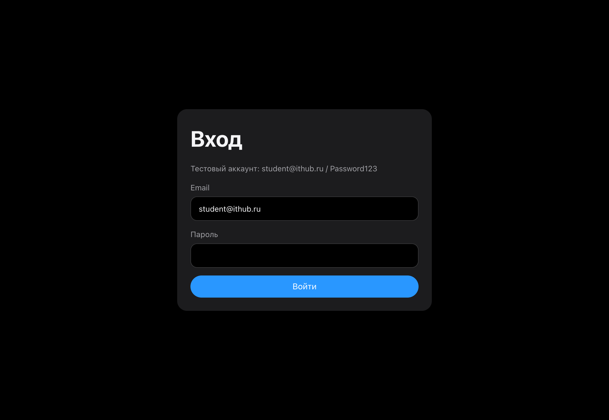

# 05 · Session management with JWT

- Login form with client validation and a 401 message.
- Access and refresh tokens in `localStorage` (`src/api/tokens.ts`).
- Request interceptor adds `Authorization: Bearer`; response interceptor catches 401, refreshes once through a shared promise (parallel requests wait for the same refresh) and retries the original request.
- Failed refresh clears tokens and redirects to `/login`.
- `restore` on startup keeps the session after F5; logout revokes tokens on the server.
- Buttons "Испортить access" / "Испортить оба" demonstrate silent refresh and forced logout; the session log shows each step.

```bash
cp .env.example .env && npm install && npm run dev
```

| Validation | Refresh and retry | After F5 | Refresh failed | Logout |
|---|---|---|---|---|
|  |  |  |  |  |
