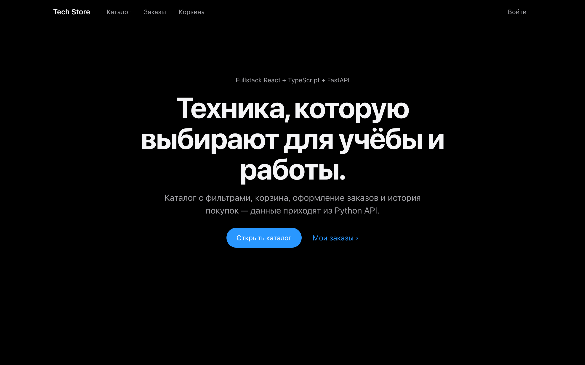
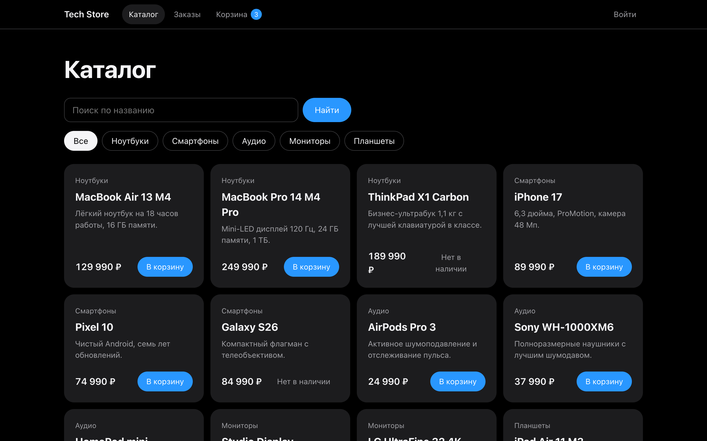
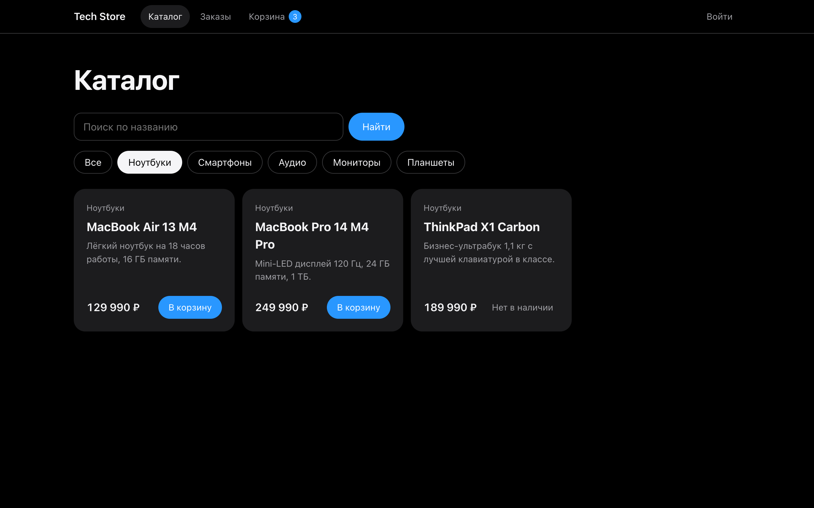
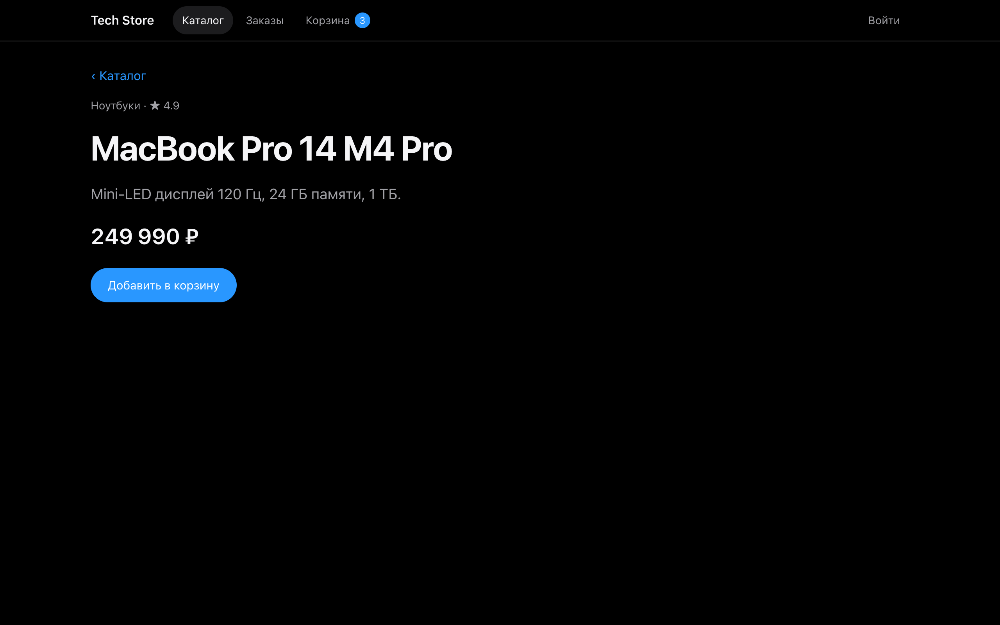
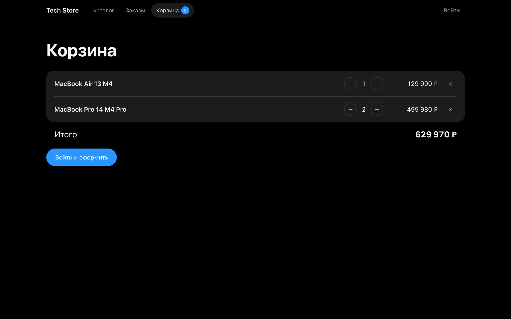
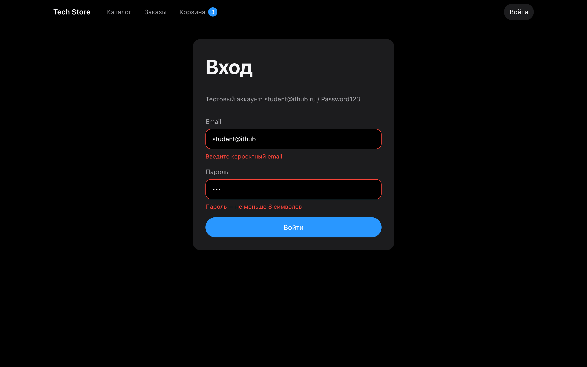
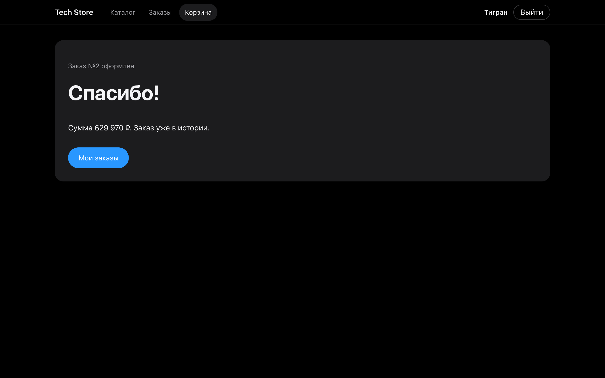
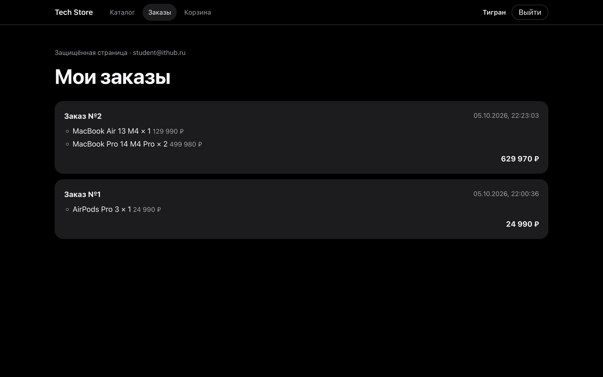
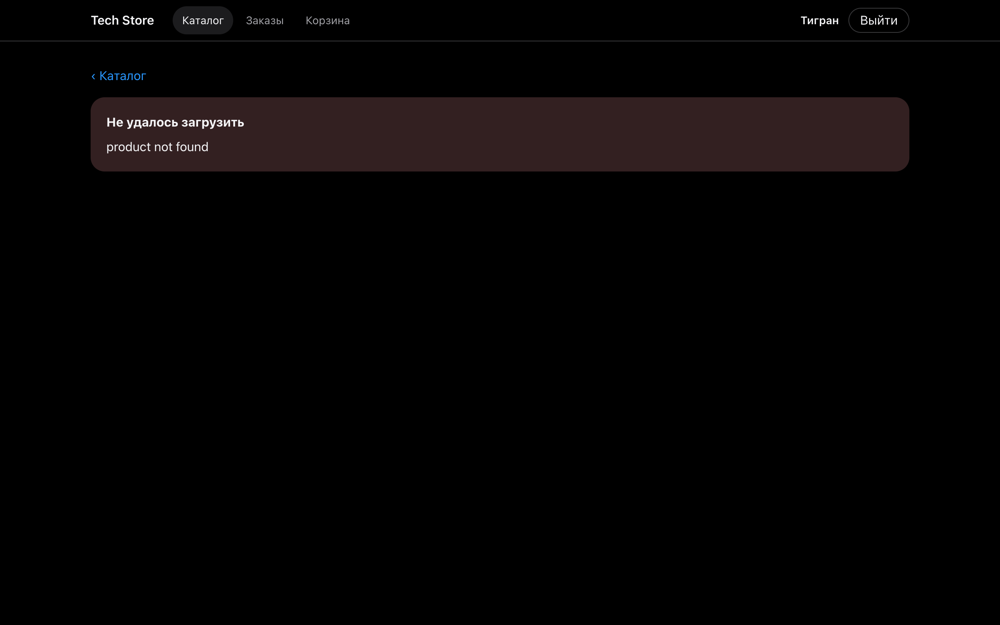
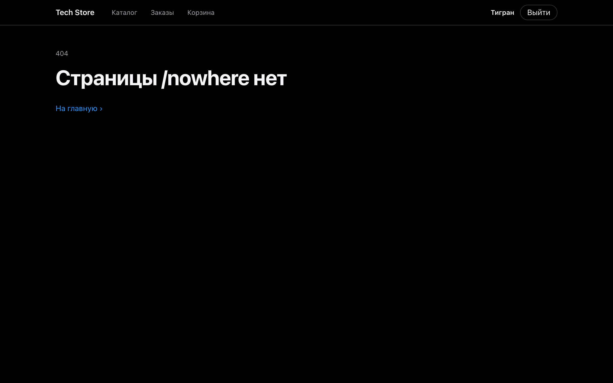

# 06 · Final project — Tech Store

A small shop on React 19 + TypeScript (strict) + Zustand + React Router 7, backed by the FastAPI [backend](../backend).

| Route | Page |
|---|---|
| `/` | home |
| `/products` | catalog: search, category chips, loading / error / empty states |
| `/products/:id` | product page with typed `useParams`, 404 handling |
| `/cart` | cart: quantities, line sums, total, checkout |
| `/login` | validated login, returns to the page that asked for it |
| `/orders` | protected order history |
| `*` | 404 |

## Structure

```
src/
  api/         axios client with JWT interceptors, typed endpoints
  store/       authStore, catalogStore, cartStore (persisted)
  types/       API types, RequestState<T>
  components/  Layout, PrivateRoute, ProductCard, Spinner, ErrorBox
  pages/       one component per route
  styles/      shared CSS Module
```

- Server state uses `RequestState<T>` so every request has explicit loading, error and success branches.
- The cart lives in a persisted Zustand store and survives reloads; the header shows the item count.
- Checkout as a guest sends the user to `/login` and back to the cart.
- Expired access tokens are refreshed silently, as in task 05.

## Run

```bash
cp .env.example .env
npm install
npm run dev
```

Test account: `student@ithub.ru` / `Password123`.

## Screenshots

| Home | Catalog | Filter |
|---|---|---|
|  |  |  |

| Product | Cart | Login redirect and validation |
|---|---|---|
|  |  |  |

| Checkout | Orders | Product error | 404 |
|---|---|---|---|
|  |  |  |  |
